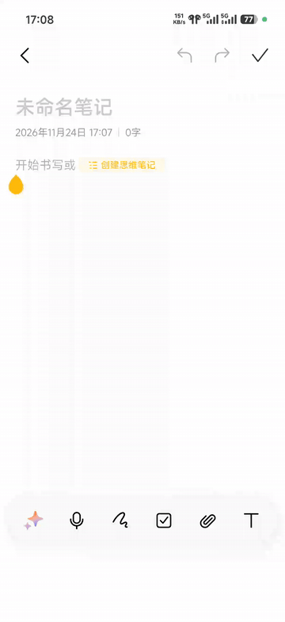

# OpenZilo Input

[简体中文](README.zh-CN.md)

Hold the button on your OpenZilo ring and speak. OpenZilo Input turns your voice into text in the Android app you already have open. Release the button to finish dictating and insert the result at the cursor. It never sends the message for you.

<a href="docs/assets/ring-dictation.mp4"></a>

[Open the 9-second demo with sound (MP4)](docs/assets/ring-dictation.mp4)

## Get started

You’ll need an OpenZilo ring and a phone running Android 13 or later. Install the `-debug.apk` from each release page below. Use the APKs for testing; unsigned AABs are not directly installable.

1. Install [OpenZilo Connect](https://github.com/ziloai/OpenZilo-Connect/releases/latest) and connect your ring in the app.
2. Install [OpenZilo Input](https://github.com/ziloai/OpenZilo-Input/releases/latest). Open it and tap **Authorize** to grant access to ring audio in Connect.
3. In OpenZilo Input, enable the input method and select it. Under **Speech recognition**, download the local models (about 418 MiB) and wait until they’re ready.
4. Tap the test field in OpenZilo Input or a text field in another app. With the OpenZilo Input panel visible, hold the ring button and speak, then release to insert the text. Each recording can last up to 60 seconds.

## Recognition and privacy

- Chinese and English can appear while you speak. The final transcription also supports Japanese, Korean, and Cantonese.
- After you release the button, the app transcribes the full recording and tidies the result, for example by removing common filler words and adding end punctuation.
- Connect provides ring audio. OpenZilo Input downloads its models once and runs recognition on the phone without uploading audio or falling back to a cloud recognizer.
- OpenZilo Input only accepts ring audio while its panel is visible in an eligible text field. Dictation is disabled in password and other private fields, and the input method keeps no audio or transcript history.

## Build from source

Use JDK 21 (as in CI), Python 3 available as `python3`, and Android SDK Platform `android-37.0` with Build Tools `37.0.0`.

```bash
./gradlew testDebugUnitTest lintDebug assembleDebug
```

The APK is built at `app/build/outputs/apk/debug/app-debug.apk`. Gradle fetches the sherpa-onnx runtime at build time; the app downloads the speech models separately.

## Community

- WeChat developer group

  

- [Discord](https://discord.gg/pTJZ3RMHA5)
- [GitHub Discussions](https://github.com/ziloai/OpenZilo/discussions)

## License

OpenZilo Input source code is licensed under the [Mozilla Public License 2.0](LICENSE). Third-party components and models retain their own licenses, including the [sherpa-onnx runtime license](app/src/main/assets/sherpa-onnx/LICENSE).
